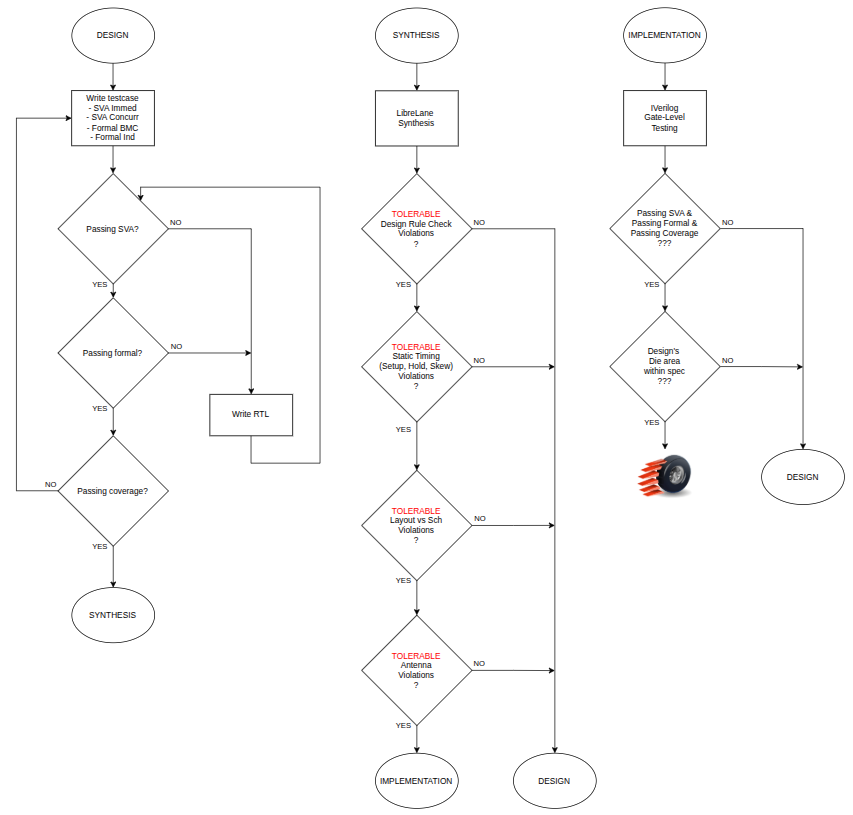
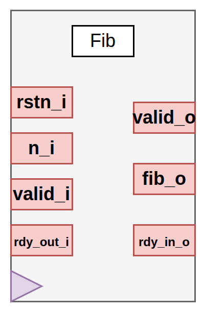
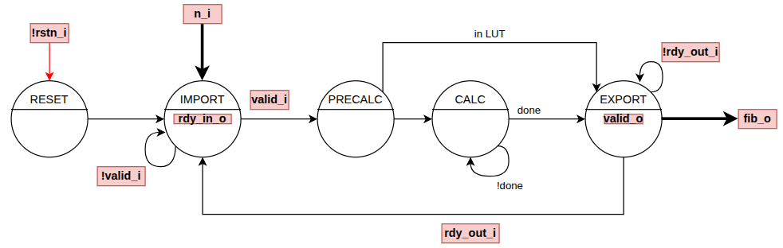
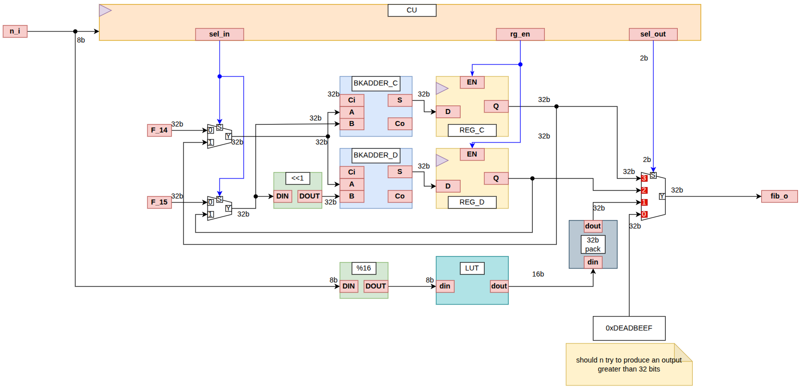

## :toolbox: Toolset
| Phase | Verilator | Icarus | Yosys | Librelane |
| ---      | --- | --- | --- | --- |
| Lint     | &check; |&check; |
| SVA      | &check; | :heavy_division_sign: |
| Formal   ||| &check; |
| Coverage | &check; |
| DRC Check|||| &check; |
| LVS Check|||| &check; |
| STA Check|||| &check; |
|Annt Check|||| &check; |
|Gate-Level|| &check; |
|Design Area|||| &check; |

:heavy_division_sign: - Icarus doesn't support concurrent SVA

##  Workflow

## Current Design

Currently producing two terms per clk at 66MHz at
a die area of 21,000 um2.

##  Task Management
- [X] DESIGN : First pass
- [X] LAYOUT : Correct STA violations 
- [X] LAYOUT : Gate-level testing
- [ ] FORMAL : Complete BMC modeling
- [ ] FORMAL : Attempt IND modeling

