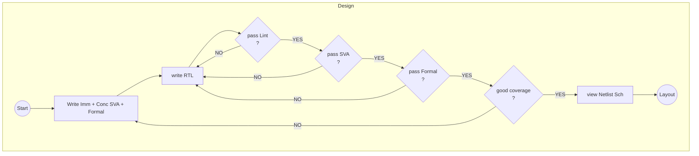

## :toolbox: Toolset
| Tool | Lint | SVA | Formal(BMC) | Formal(Ind) | Netlist schematic | Synth + Impl | Design Checks |
| --- | --- | --- | --- | --- | --- | --- | --- |
| Verilator | &check; |  &check; |  |
| Icarus | &check; |  &check; (no concurr) |  |
| Yosys |  |  | &check; | &check; | &check; |
| LibreLane | | | | | | &check; | &check; |

##  Workflow

## TODO
- [X] DESIGN : First pass
- [ ] LAYOUT : Correct STA violations 
- [ ] LAYOUT : gate-level testing

